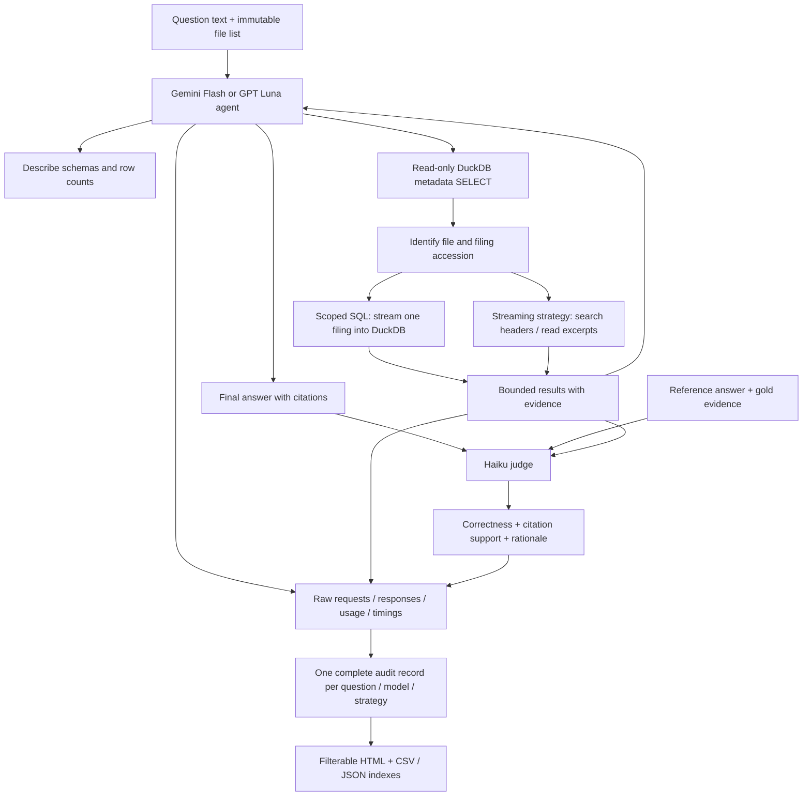

# Whole-corpus Parquet agent: architecture and audit guide

## Data and scope

The recorded source snapshot contains **638,067 filing rows in six Parquet files**,
with **6,914,044,276 compressed bytes (6.44 GiB)**. A row is a filing record, not a
retrieval chunk; the count does not claim that all records are unique documents.
No part of the corpus is copied into a vector database for this experiment.

| Source | Filing rows | Compressed GiB |
|---|---:|---:|
| January 2025 | 90,711 | 0.813 |
| February 2025 | 128,993 | 1.208 |
| March 2025 | 118,933 | 1.317 |
| April 2025 | 109,085 | 1.325 |
| May 2025 | 126,665 | 1.312 |
| June 2025 | 63,680 | 0.464 |
| **Total** | **638,067** | **6.44** |

The schema includes `accession` (company CIK, possibly zero-padded), `file_stem`
(filing accession), `year`, `month`, `parsed_md`, `char_count`, `md5`, `has_ocr`,
and `source_format`. Company names, form types and financial tables are primarily
inside Markdown, so some searches still require decompression. This design avoids
additional chunking, embedding and vector-index construction; it still requires
the already-parsed source files and does not eliminate text-scan costs.

There are 100 prepared questions with references. Two answer models × two retrieval
strategies means four cases per question: 80 cases for 20 questions, 400 for all
100. Every completed answer is separately judged by Haiku. The gold answer and
gold evidence enter only the judge request, never the search agent's input.

## Flow



`src/agentic_search_only/parquet_agent.py` orchestrates the run. It samples questions,
freezes inputs and code hashes, preflights the corpus and models, runs a bounded
agent loop, saves checkpoints, invokes the judge and produces summaries.

`src/agentic_search_only/pinned_client.py` sends provider-pinned API requests. It saves each
request before sending and each response before validating it. Retry attempts,
transport failures, malformed replies and returned usage remain auditable. Each
POST records requested/actual model and provider, temperature if supported,
reasoning effort, UTC timestamps, queue/attempt duration, response ID, finish
reason, all token/cost details, and raw-file paths. Metadata discovery GETs have
a separate audit. Authorization headers are excluded and credential echoes are
redacted. A missing provider identity is marked unverified, not asserted to match.

`src/agentic_search_only/parquet_worker.py` runs local data operations in isolated processes.
The SQL strategy offers schema discovery and SELECT. The SQL-plus-streaming
strategy also offers paginated issuer-header searches and targeted filing reads.
When querying Markdown through SQL, the optional exact `file_stem` scope streams
one source row into DuckDB first. This avoids decoding a large batch of Markdown
cells before a WHERE filter takes effect. Null or empty optional scope means a
normal metadata query. Source excerpts are capped and have source IDs and offsets
when using the filing-read tool. SQL expressions/arguments remain in the trace.

The agent receives tool outputs as normal `role=tool` messages. **There is no
separate reranker or final evidence-selection pass.** The final-answer request
contains the accumulated conversation and tool outputs actually sent at that
point. The audit preserves that request verbatim, rather than guessing which
retrieved passages the model relied on. Citations indicate claimed support; they
do not reveal the model's private internal reasoning.

Haiku receives the candidate, reference, gold evidence and full tool evidence.
It returns correctness 0–100, citation support 0–100 and a rationale. Correctness
and citation support are separate: an honest abstention can have high support but
low correctness when the reference is answerable. These are model judgments, not
a guarantee of objective correctness.

## How to inspect any case

Open `reports-whole-data/<run>/report.html`, then choose the question, model and
strategy in the filters. Expand the matching case to see:

1. Question, reference, model/provider, status and final answer.
2. Tool counts, model rounds, API attempts, cost and timing.
3. Each tool name, exact arguments/SQL, returned data, offsets, errors and cache use.
4. The exact complete request used to generate the final answer, including messages.
5. The exact request sent to Haiku, its raw response, both scores and rationale.
6. Every API attempt's parameters, usage and links to full request/response files.

`cases-index.json` and `cases-index.csv` provide one row per case. They include
question/model/method identifiers, counts, answer, scores, rationale, costs and a
link to `cases/<task_id>.json`. The per-case JSON is self-contained for the evidence,
final sent context and judge input; links use paths relative to the run directory.
Full earlier request/response payloads remain in `raw/`.

For a programmatic lookup:

```bash
.venv/bin/python -m agentic_search_only.case_audit \
  reports-whole-data/smoke-verified-20261015 \
  --question Q001 --model openai/gpt-6-luna --method sql --full
```

The exporter is offline and also backfills existing saved runs. It never changes
original result files, request logs or original run provenance, and does not call
models or scan the source data. `case-export-provenance.json` records its own
version hash and the source-result hashes. Future benchmark runs create these
exports automatically during report generation. Changed benchmark code requires
a new run directory under the existing immutable-manifest policy.

Tool count definitions are deliberately distinct:

| Field | Meaning |
|---|---|
| `requested_by_model` | Tool calls emitted in successfully recorded agent turns, including calls later rejected. |
| `processed` | Tool responses produced, including validation errors and budget rejections. |
| `budgeted_attempts` | Attempts admitted under the agent's tool budget, even if validation fails. |
| `dispatched` | Calls reaching the tool executor; includes cache lookups. |
| `cache_hits` | Calls served from the shared successful-result cache. |
| `source_worker_runs` | Dispatched calls not served from cache. |
| `errors` / `budget_rejected` | Explicit tool-error responses / subset rejected by tool budget. |
| `model_rounds` / `api_attempt_count` | Successful agent turns / all answer-plus-judge HTTP attempts, including retries. |

For an incomplete answer, the exporter uses available durable API/tool journals,
marks the case incomplete, shows the latest available sent context, and does not
invent a final answer or score. Missing raw requests are listed. Tool outputs not
present in the final/latest request are listed by call ID; a retrieved output is
not assumed to have been sent just because it exists in a trace.

## Resource and concurrency design

The complete process tree has a 2 GiB memory ceiling, no swap, one CPU equivalent,
and at most 128 tasks. Each data worker also has 1.5 GiB address space, 20 CPU
seconds and a 30-second wall timeout. DuckDB uses one thread, 128 MiB, no spill,
no extension loading and an approved-source-file allowlist. Only one SELECT is
accepted. Workers do not inherit gateway credentials.

There are four concurrent case/API workers, but only one local data tool at a time.
Every completed turn/case is checkpointed. Identical successful tool calls can
share a cache; cache hits are recorded because they affect latency. Use
`--cache-policy off` for an uncached timing comparison. New source files arriving
mid-run are excluded from its initial snapshot and recorded; changes to an
existing snapshotted file invalidate the comparison. This is concurrent request
processing, not a discounted provider Batch API.

## Measured smoke outcome and expectations

The primary saved smoke run used **Q001 and Q002**, both on the same Alphabet
filing. All eight cases completed. Mean correctness was Flash SQL 99, Flash
streaming 99, Luna SQL 97, and Luna streaming 100. These two closely related
questions verify integration only; they cannot predict accuracy on the remaining
questions or establish a model ranking.

The run reported **$0.11326388**, including health checks and judging, across 59
inference requests. Its first pass took **60.76 seconds** with four case workers.
Peak process-tree memory was **964.69 MiB**, with zero swap and OOM kills. A resume
made no new inference calls. The four preserved development/verification runs
reported $0.43885210 in total; those charges are recorded rather than discarded.

A mechanical scaling of that tiny smoke run would suggest about **$1.13 and 10
minutes for 20 questions**, or **$5.66 and 51 minutes for 100**, across both models
and strategies. These are **not forecasts**: longer conversations repeatedly send
context, multi-filing questions need more tool calls, unfamiliar issuers can force
scans, cache reuse will be lower, and timeouts/retries may increase both cost and
time. For planning, allow roughly **$2–$5 for a random-20 run** and **$10–$25 for
all 100**, then revise from measured early cases and current gateway pricing.
No API batch discount or accuracy percentage is assumed.

Expected behavior is evidence-based answers when the agent locates enough data,
and explicit limitations when it cannot within the tool budget. The full report
should compare quality, citation support, coverage/completion, tool effort,
latency, cost and resource use together. It should not count a failed search as
proof that the corpus lacks an answer.
